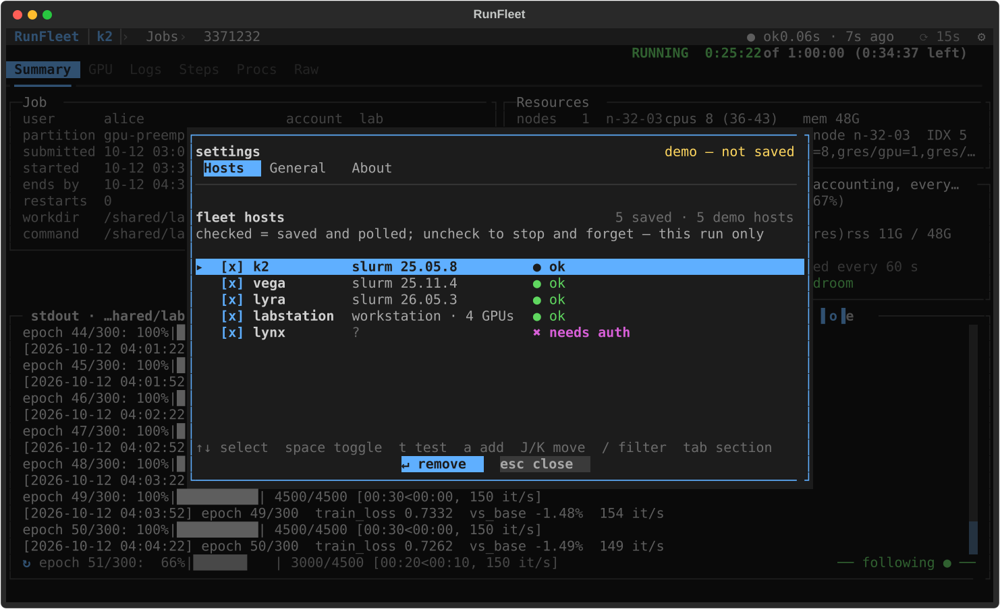

# RunFleet

An nvitop-like terminal UI for **Slurm clusters and GPU workstations over SSH**. It shows every job, GPU and host
in your fleet in one place: live queues and history, per-GPU bars with processes, log tails with follow, failure
forensics and stall hints, plus safe, confirmed actions (cancel, hold, release, requeue, terminate).

- **One view of everything.** Slurm jobs (running, pending, recently finished) and workstation tasks (process
  trees of your launchers) in one table you can filter, sort and drill into.
- **Nothing to install remotely.** It uses your own OpenSSH client and `~/.ssh/config` (ProxyJump, ControlMaster,
  keys, Duo) and runs read-only commands that already exist on the host: `squeue`, `sacct`, `scontrol`, `sstat`,
  `sinfo`, `nvidia-smi`, `ps`, `/proc`.
- **Light on shared login nodes.** One SSH round trip per host per refresh, about 4 per minute for a visible Slurm
  host (≈ `watch -n 15 squeue --me`), slower when the host is off screen, paused after 2 h without input.
- **Never crashes because of a host.** An unreachable host, an expired login or a hung `nvidia-smi` becomes a badge,
  a stale marker and a retry schedule; the last known data stays on screen.
- **Tells you what happened.** Failures, restarts and jobs about to hit their time limit raise a notification (toast,
  terminal / desktop, or your own command), and a "since you were away" note sums up the night. Ended jobs get a cause
  chip (`OOM-GPU`, `NCCL`, `TIMEOUT`, …) with the log line behind it and an efficiency card with the `--time` /
  `--mem` to ask for next time.
- **Safe by default.** Every action is confirmed and shows the exact remote command; `--readonly` disables all of
  them; protected partitions/QOS (your PI's queue) can never be touched.

> **Status:** v0.1 (alpha). Tested against Slurm 25.05, 25.11 and 26.05 and Linux workstations with NVIDIA GPUs; no
> PyPI release yet. The design and its reasoning live in [`docs/DESIGN.md`](docs/DESIGN.md), changes in
> [`CHANGELOG.md`](CHANGELOG.md).

## Screenshots

<!-- Generated from the demo fleet: `uv run python scripts/screenshots.py` (writes docs/screenshots/*.svg). -->

| Fleet overview | Jobs |
|---|---|
|  |  |
| **GPUs** | **Job detail** |
|  |  |
| **Settings** | |
|  | |

## Install

RunFleet needs Python ≥ 3.11 and the system OpenSSH client (`ssh`). It runs on Linux and macOS (Windows: WSL).

There is no PyPI release yet; install straight from GitHub:

```sh
uv tool install git+https://github.com/Yuanpeng-Li/runfleet   # puts `runfleet` on your PATH
pipx install git+https://github.com/Yuanpeng-Li/runfleet      # the same with pipx
uvx --from git+https://github.com/Yuanpeng-Li/runfleet runfleet --demo   # try it without installing
```

Uninstall with `uv tool uninstall runfleet` (or `pipx uninstall runfleet`). From a clone, `uv tool install .` works the
same, and `uv build` makes a wheel (`uv tool install dist/runfleet-0.1.0-py3-none-any.whl`).

## Quickstart

Host names are your own `~/.ssh/config` aliases; the examples use the demo fleet's (`k2`, `vega`, `lyra`,
`labstation`, `lynx`).

```sh
runfleet --demo                 # a simulated fleet (3 clusters, 2 workstations); no network, nothing to set up
runfleet                        # your fleet; with no config yet it offers the hosts in ~/.ssh/config
runfleet k2 labstation          # only these hosts this run; new ones are saved once they answer
runfleet connect lyra           # log in once in this terminal (Duo / password); RunFleet reuses the connection
runfleet hosts import --all --write   # probe every ssh alias (read-only) and save the ones that answer
runfleet doctor lyra            # why is a host not working? ssh, multiplexing, detection, capabilities
runfleet snapshot --json        # poll once and print the whole fleet as JSON (schema runfleet.snapshot/1)
runfleet wait k2:2332861 && ./eval.sh   # block until the job ends (exit 0 = completed)
```

Inside the TUI: `tab` switches Fleet → Jobs → GPUs, `enter` drills in, `/` filters, `l` opens the log, `x` lists
actions, `,` opens **Settings**, `?` shows every key for the current view, `q` goes back or quits. See the
[user guide](docs/USER_GUIDE.md) and the [configuration reference](docs/CONFIG.md).

Settings (`,`, or the `⚙` at the top right) is where the fleet is managed after the first start: every
`~/.ssh/config` alias with a checkbox — check to save it and start polling it at once, uncheck to stop and forget it,
`t` to test it, `a` to add a target that is not in your ssh config, `J`/`K` to reorder — plus the refresh speed,
read-only default, mouse, idle pause and default view. It edits `config.toml` without touching your comments.

A first config (`~/.config/runfleet/config.toml`) can be as small as:

```toml
[[host]]
name = "k2"                     # an ssh alias from ~/.ssh/config
protected_qos = ["labpi"]       # never offer actions on jobs in this QOS

[[host]]
name = "labstation"
```

## How it works

Each refresh renders one POSIX `sh` script per host, framed into named sections (each under a remote `timeout`), and
sends it through `ssh … 'exec sh -s'` on your existing ControlMaster (or a RunFleet-managed one when your config has
none). Parsers turn the real command output into one job model shared by Slurm jobs and workstation tasks. Background
`ssh` processes run without a terminal and with `BatchMode=yes`, so they can never prompt; when a host needs a login
the UI tells you to press `c`, which suspends the TUI and runs `ssh` in your terminal.

## Development

```sh
git clone https://github.com/Yuanpeng-Li/runfleet && cd runfleet
uv sync
uv run runfleet --demo          # the dev environment: no cluster, no GPU needed
uv run pytest -q
uv run ruff check .
uv run mypy
```

The tests need no network: parsers run against anonymised command output captured on real clusters and
workstations (`tests/fixtures/samples/`), and the UI runs on the simulated fleet. `uv run pytest -m real` and
`scripts/smoke_real.sh HOST …` do contact real hosts (read-only); run them only by hand, against hosts you are allowed
to probe. The smoke script budgets ≤ 3 ssh sessions per host for `doctor` + `snapshot`, plus at most one master login
(with its jump hop) when a RunFleet-managed master has to be created.

`uv build` makes the wheel and a source archive; the sdist is a whitelist (`src`, `scripts`, `docs/*.md`, screenshots,
README, CHANGELOG, LICENSE); the test suite ships with the git repository only.

## License

MIT — see [LICENSE](LICENSE).
