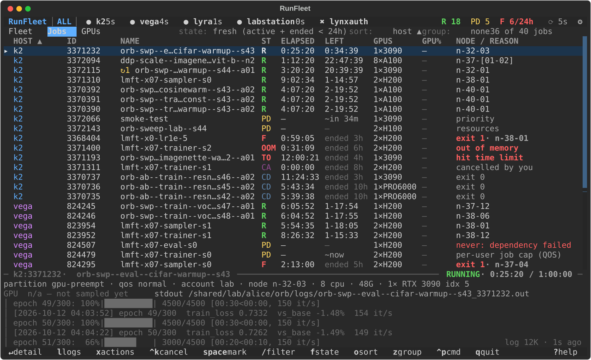
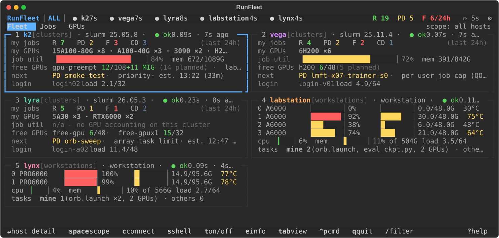
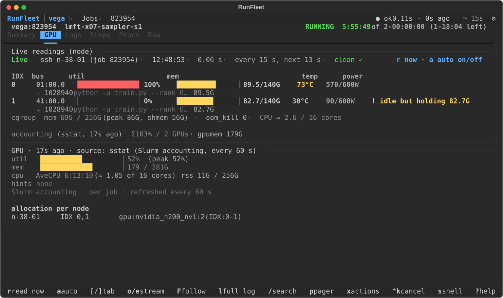
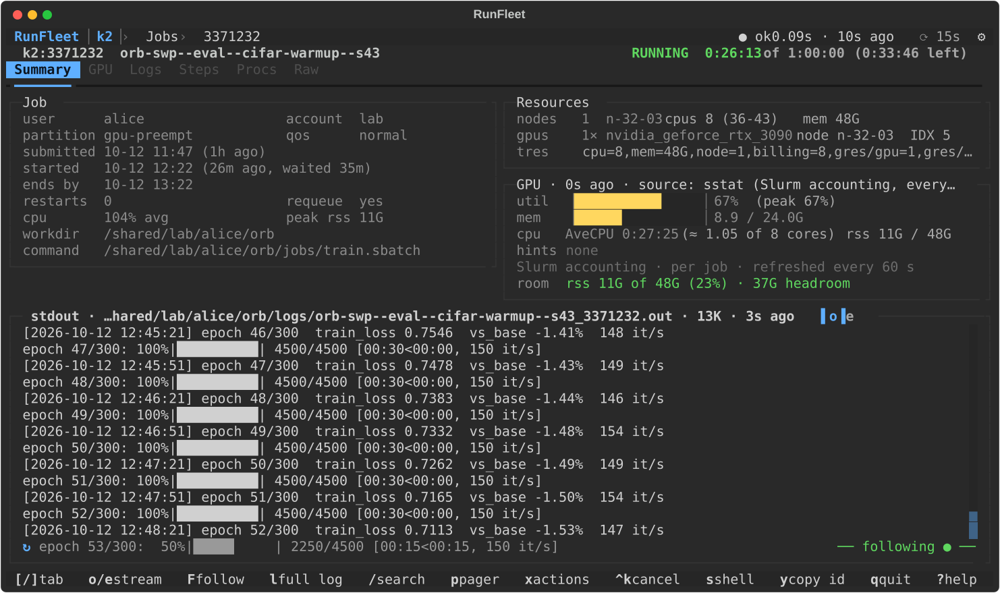
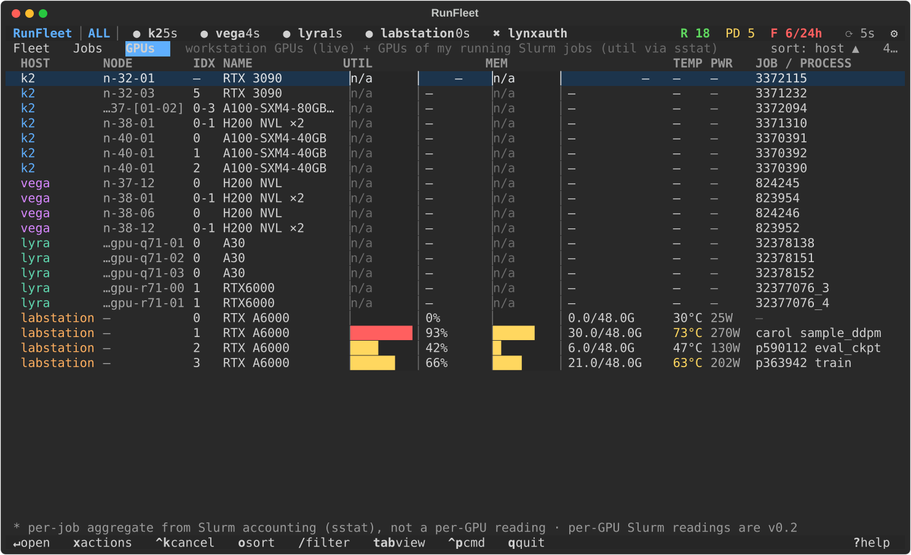

<div align="center">

# RunFleet

**All your Slurm jobs and GPU machines in one terminal.**

Queues, GPUs, logs and failures across every cluster and workstation you can `ssh` into —<br>
with nothing to install on the remote side.

[](https://github.com/Yuanpeng-Li/runfleet/actions/workflows/ci.yml)


[](LICENSE)



</div>

If you run experiments on more than one machine, you probably know the routine: log in to cluster A for `squeue`,
cluster B for `sacct`, a workstation for `nvidia-smi`, then `tail -f` a log to see why a job died. RunFleet does that
rounds for you. It polls each host over your own SSH setup and puts everything in one keyboard-driven view: what is
running, what is waiting and why, which GPUs are busy or idle, and what went wrong with the jobs that ended.

Try it right now on a simulated fleet (no account, no cluster, no network):

```sh
uvx --from git+https://github.com/Yuanpeng-Li/runfleet runfleet --demo
```

## A quick tour

### Every host at a glance

One card per host: your running / pending / failed jobs, the GPUs you hold, utilisation, free GPUs per partition,
the next job in line with its estimated start, and login-node load. Workstations show per-GPU bars instead.



### Live GPU readings inside a running job

Slurm accounting only tells you a job's *average*. Open a running job's **GPU** tab and RunFleet reads the job's own
node on demand: per-GPU utilisation and memory, which process sits on which GPU, cgroup memory and OOM kills. Here
it catches a two-GPU job whose second GPU has been idle while holding 82.7 GB — invisible in the job's 52 % average.



### Job detail and logs

Times, resources, efficiency against what you asked for, and the job's stdout following live. Ended jobs get a cause
chip (`OOM-GPU`, `NCCL`, `TIMEOUT`, …) pointing at the log line behind it, and a hint for the `--time` / `--mem` to
request next time.



### All GPUs in one table

Workstation GPUs live, cluster GPUs of your running jobs from Slurm accounting, sorted and filterable.



## Why it is pleasant to live with

- **Nothing to install remotely.** It uses your OpenSSH client and `~/.ssh/config` as they are (ProxyJump,
  ControlMaster, keys, Duo / 2FA) and only runs commands that are already there: `squeue`, `sacct`, `scontrol`,
  `sstat`, `sinfo`, `nvidia-smi`, `ps`, `/proc`.
- **Gentle on shared login nodes.** One SSH round trip per host per refresh — about the load of
  `watch -n 15 squeue --me` — slower for hosts off screen, paused when you walk away.
- **Calm when hosts are not.** An unreachable host, an expired login or a hung `nvidia-smi` becomes a badge and a
  retry; the last known data stays on screen and nothing crashes.
- **Tells you what happened.** Failures, requeues and jobs about to hit their time limit raise a notification (in the
  app, terminal / desktop, or a command of your own), and a "since you were away" note sums up the night.
- **Safe by default.** Cancel, hold, release, requeue and terminate are always confirmed and show the exact remote
  command. `--readonly` turns them all off, and partitions or QOS you mark as protected are never touched.

## Install

You need Python 3.11+ and the system `ssh` client. Linux and macOS work; on Windows use WSL.

```sh
uv tool install git+https://github.com/Yuanpeng-Li/runfleet     # recommended
# or
pipx install git+https://github.com/Yuanpeng-Li/runfleet
```

There is no PyPI release yet, so installs come straight from GitHub.

## Update

```sh
uv tool upgrade runfleet       # if you installed with uv
pipx reinstall runfleet        # if you installed with pipx
```

Both fetch the latest `main` and rebuild. Your config (`~/.config/runfleet/config.toml`), saved hosts and cache are
left alone. If RunFleet is open, quit and start it again to pick up the new version. What changed is listed in
[CHANGELOG.md](CHANGELOG.md).

For `uvx`, add `--refresh` once to bypass its cache:
`uvx --refresh --from git+https://github.com/Yuanpeng-Li/runfleet runfleet`.
From a clone: `git pull && uv tool install --force .`

To remove it: `uv tool uninstall runfleet` or `pipx uninstall runfleet`.

## Getting started

```sh
runfleet                    # first run: pick hosts from your ~/.ssh/config
runfleet gpu-a mylab        # only these ssh aliases this time
runfleet connect gpu-a      # log in once in this terminal (Duo / password); RunFleet reuses the connection
runfleet doctor gpu-a       # why does a host not work? ssh, multiplexing, detection, capabilities
runfleet snapshot --json    # poll once and print the whole fleet as JSON
runfleet wait gpu-a:123456 && ./eval.sh    # block until a job ends (exit 0 = completed)
```

Host names are your own `~/.ssh/config` aliases; RunFleet works out by itself whether each one is a Slurm cluster or
a plain GPU machine.

Inside the app:

| Key | | Key | |
|---|---|---|---|
| `tab` | Fleet → Jobs → GPUs | `l` | open the log |
| `enter` | open a host or job | `x` | actions (cancel, requeue, …) |
| `/` | filter (`host:gpu-a state:R user:me`) | `,` | settings |
| `[` `]` | switch tabs in a job | `?` | every key for this view |
| `c` | log in to a host that needs it | `q` | back / quit |

Hosts are managed in **Settings** (`,`): every ssh alias with a checkbox — check to start polling it, uncheck to
forget it, `t` to test. It writes `~/.config/runfleet/config.toml` for you and keeps your comments. A hand-written
config can be as small as:

```toml
[[host]]
name = "gpu-a"                 # an ssh alias
protected_qos = ["pi-queue"]   # never offer actions on jobs in this QOS

[[host]]
name = "mylab"
```

More in the [user guide](docs/USER_GUIDE.md) and the [configuration reference](docs/CONFIG.md).

## How it works

Each refresh sends one small POSIX `sh` script per host through `ssh … 'exec sh -s'`, reusing your ControlMaster (or
one RunFleet manages when you have none). The script is split into named sections, each under its own remote
`timeout`, so one slow command cannot stall the rest. Parsers turn the output into a single job model shared by Slurm
jobs and workstation processes. Background `ssh` runs with `BatchMode=yes` and never prompts; when a host needs a
login, RunFleet asks you to press `c` and hands the terminal to `ssh`. The full design is in
[docs/DESIGN.md](docs/DESIGN.md).

## Development

```sh
git clone https://github.com/Yuanpeng-Li/runfleet && cd runfleet
uv sync
uv run runfleet --demo      # no cluster or GPU needed
uv run pytest -q
uv run ruff check . && uv run mypy
```

Tests need no network: parsers run against anonymised output captured on real clusters and workstations
(`tests/fixtures/samples/`), and the UI runs on the simulated fleet. `uv run pytest -m real` and
`scripts/smoke_real.sh HOST …` do contact real hosts (read-only), so run them by hand and only against hosts you are
allowed to probe. Screenshots come from `uv run python scripts/screenshots.py`.

## License

MIT — see [LICENSE](LICENSE).
